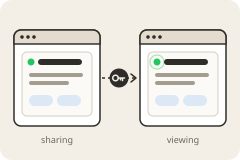

<p align="center">
  
</p>

# Workspace pairing: share a live app between two Minds

<p align="center">
  <a href="https://boweiliu.github.io/open-in-minds/?git_url=https://github.com/boweiliu/workspace-pairing"></a>
</p>

Didn't work? Create a Mind workspace and paste this to your agent:
` /use-template https://github.com/boweiliu/workspace-pairing`

## Why you care

Pair two Mind workspaces with a single-use, expiring invite so one can view something the other is sharing live, with no account sign-in. Demonstrated with a simple example status card app.

Today, letting someone else's Mind see something from yours means they sign in
through a full browser flow; there is no built-in way for one workspace to show
another a live view without that sign-in. This adds one: pair the two workspaces once
with a code you send by DM, and the other side can watch what you share as it
updates, while everyone else is refused -- and you can cut them off at any time.

## How to use it

There are two roles: the workspace **sharing** something, and the workspace
**viewing** it. The thing shared here is an example status card; the pairing works the
same for any app you point it at.

**Sharing side (you)**

1. *Set up the tunnel, once.* Create a free ngrok account, give your agent your ngrok
   auth token when it asks, and replace the placeholder
   `your-tunnel-domain.ngrok-free.dev` with your own ngrok domain in
   `system/supervisord.conf.d/task-status-tunnel.conf` and
   `system/apps/task_status/tunnel/create_invite.py`. Then
   `supervisorctl restart task-status-tunnel`.
2. *Put something on the card.* Write `data/.apps/task-status/status.json`; the card,
   and every paired viewer's live stream, updates within about a second:

   ```json
   {"title": "Q3 report", "status": "Drafting the summary", "agent_active": true,
    "links": {"draft": "https://example.com/draft"}}
   ```

3. *Invite a viewer.* Pick a short name for them and run:

   ```bash
   python3 system/apps/task_status/tunnel/create_invite.py peer-studio
   ```

   It prints an address, the name, a code, and an expiry. DM those lines to the other
   workspace's owner over a private channel. The code works once and expires in 24
   hours.
4. *Revoke a viewer.* Delete their line from `data/.apps/task-status/allowed_signers`.
   Their next request is refused, and a live stream they already have open is cut
   within 30 seconds.

**Viewing side (the peer)**

The viewer needs `system/apps/task_status/tunnel/peer_client/` in their own workspace:
copy that directory over (it depends only on Python and `ssh-keygen`), or adopt this
template there too. Then, with the lines from the DM:

```bash
python3 pair.py https://their-domain.ngrok-free.dev peer-studio <code>   # once
python3 view.py peer-studio                                              # fetch the card
```

`pair.py` makes the viewer's own key and registers it; nothing else about them reaches
the sharer. `view.py` fetches the shared page once, signing the request. It is not a
live view yet: for that, build the same signing into a viewer app of your own that
follows the card's live `/events` stream (see the ideas below).

## Ideas for making it yours

- **Share something else.** Point the gate at a different app of yours by setting
  `STATUS_GATE_UPSTREAM_PORT` in `system/supervisord.conf.d/task-status-gate.conf` --
  a project dashboard, a reading list, the output of a long-running job -- and drop
  the example card.
- **Build a real live viewer.** Replace the one-shot `view.py` with an app on the
  viewing side that re-signs on its own, follows the `/events` stream, and shows the
  card in a window that updates as it changes.
- **Make it two-way.** Install the gate and tunnel on both workspaces and exchange
  invites in both directions, so each side can see what the other is working on.
- **Keep a pairing log.** Record who was invited, when each invite was redeemed, and
  when a viewer was revoked, and show it on a small page next to the shared app.
- **Tighten the time limits.** Lower the invite lifetime (`INVITE_LIFETIME_SECONDS` in
  `invites.py`) or the gate's maximum token lifetime for more sensitive shares.

## What this is

This repository is a published **minds template**: a clean, bootable
snapshot of what a mind built, ready to adapt into your own. It is NOT the
generic workspace template -- it is this specific project.

[`template.md`](template.md) is the full manifest -- what it is, how it
works, what it needs to run, and what to adapt -- with the
machine-readable half (recipe, requirements, and the environment it needs
installed) in [`template.toml`](template.toml).
